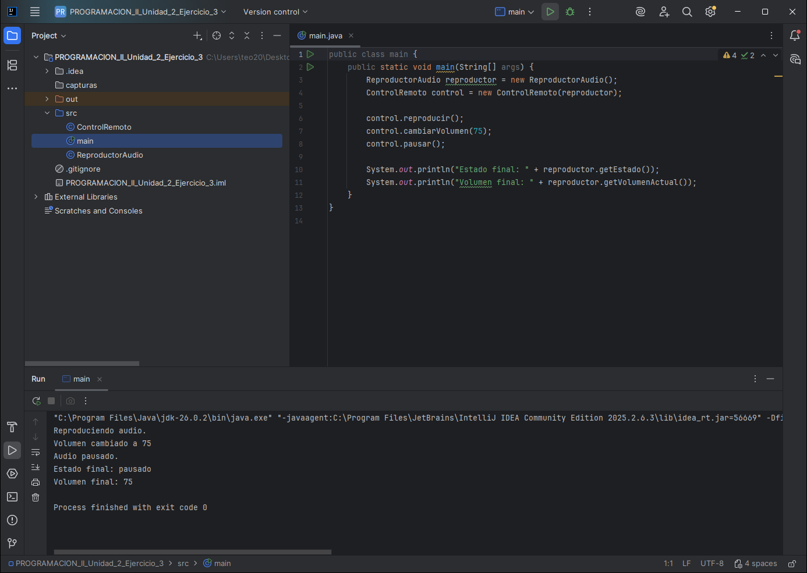

# PROGRAMACIÓN II — Unidad 2, Ejercicio 3: El Sistema de Audio y Reproducción Multimedia

Trabajo práctico de Programación II. Este repositorio contiene la resolución en Java del ejercicio 3 de la Unidad 2.

## Consigna

#### Contexto

En los reproductores multimedia modernos, el control remoto o la interfaz de usuario no manipula directamente los archivos de audio; en su lugar, envía mensajes de control (reproducir, pausar, subirVolumen) a un objeto dedicado al manejo del hardware o software de sonido.

#### Consigna

Construir un diagrama de clases y su respectivo código en Java donde un objeto ControlRemoto envíe mensajes de control a un objeto ReproductorAudio.

#### Desarrollo requerido

- Definir la clase ReproductorAudio con atributos como volumenActual, estado (reproduciendo, pausado, detenido) y métodos de acción (play(), pause(), cambiarVolumen(int nuevoVolumen)).
- Crear la clase ControlRemoto que mantenga una asociación (referencia) con el ReproductorAudio.
- Incorporar validaciones dentro de los métodos del reproductor para que los mensajes no alteren el estado de manera inválida (por ejemplo, volumen entre 0 y 100).
- En el método main, instanciar el reproductor y el control remoto, y simular una secuencia de mensajes (reproducir, cambiar volumen, pausar) imprimiendo los cambios por consola.

## Estructura del repositorio

```
PROGRAMACION_II_Unidad_2_Ejercicio_3/
├── README.md
├── capturas/
│   └── consola.png
└── src/
    ├── ControlRemoto.java
    ├── main.java   # clase con el método main
    └── ReproductorAudio.java
```

## Funcionamiento y lógica

El ejercicio muestra cómo un objeto controla a otro enviándole mensajes: el control remoto no reproduce audio, le pide al reproductor que lo haga.

### `ReproductorAudio`

Guarda su estado interno en los atributos privados `volumenActual` y `estado`. Arranca **detenido** con volumen **50**.

- **`play()`:** cambia el estado a "reproduciendo".
- **`pause()`:** solo pausa si el reproductor está reproduciendo; si no, avisa que no se puede pausar.
- **`cambiarVolumen(int)`:** acepta valores entre 0 y 100; fuera de ese rango informa que el volumen es inválido.
- **Getters:** devuelven el estado y el volumen actual.

### `ControlRemoto`

Recibe el reproductor en el constructor y lo guarda como atributo. Cada uno de sus botones (`reproducir()`, `pausar()`, `cambiarVolumen()`) **delega** la acción llamando al método correspondiente del reproductor.

### `main`

Crea el reproductor y el control conectado a él. Con el control reproduce, sube el volumen a 75 y pausa. Al final consulta el reproductor: el estado es **pausado** y el volumen **75**.

## Ejecución

Captura de la consola de IntelliJ IDEA ejecutando el programa:



Salida obtenida:

```
Reproduciendo audio.
Volumen cambiado a 75
Audio pausado.
Estado final: pausado
Volumen final: 75
```
